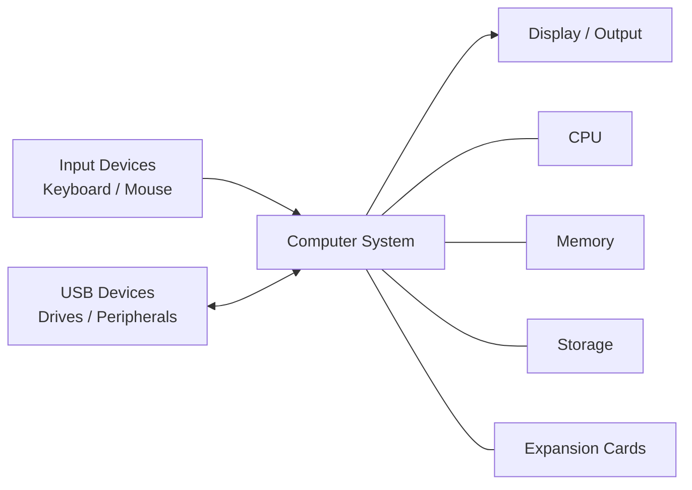
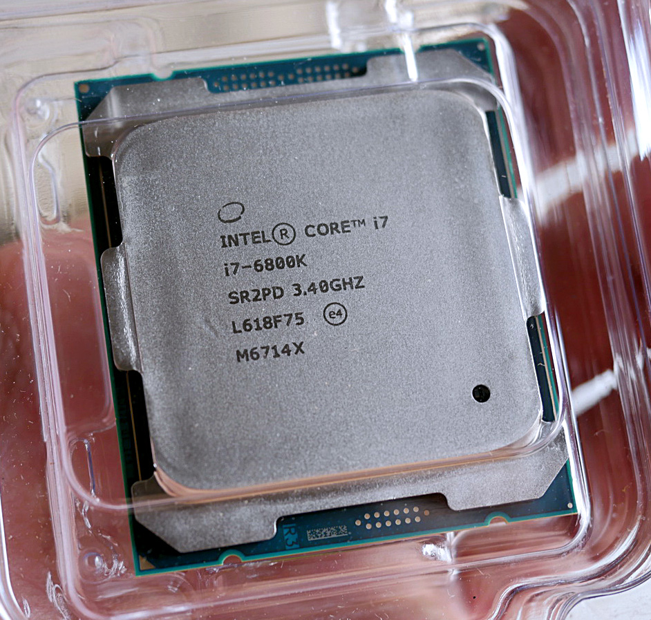
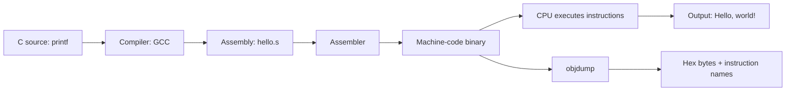
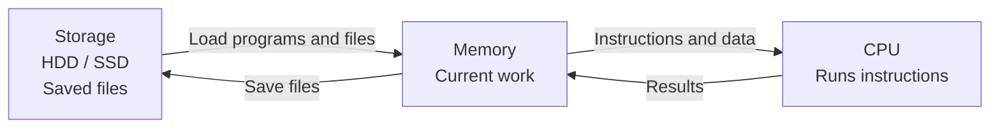
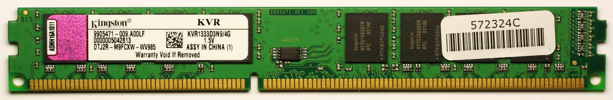
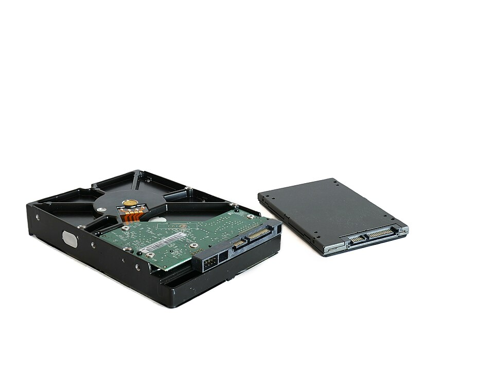
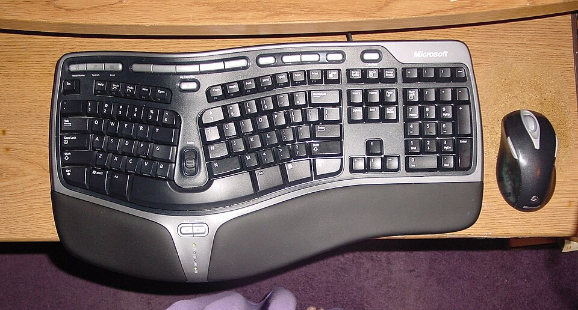
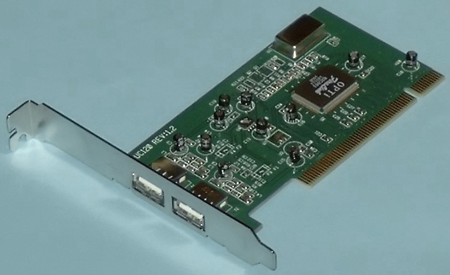
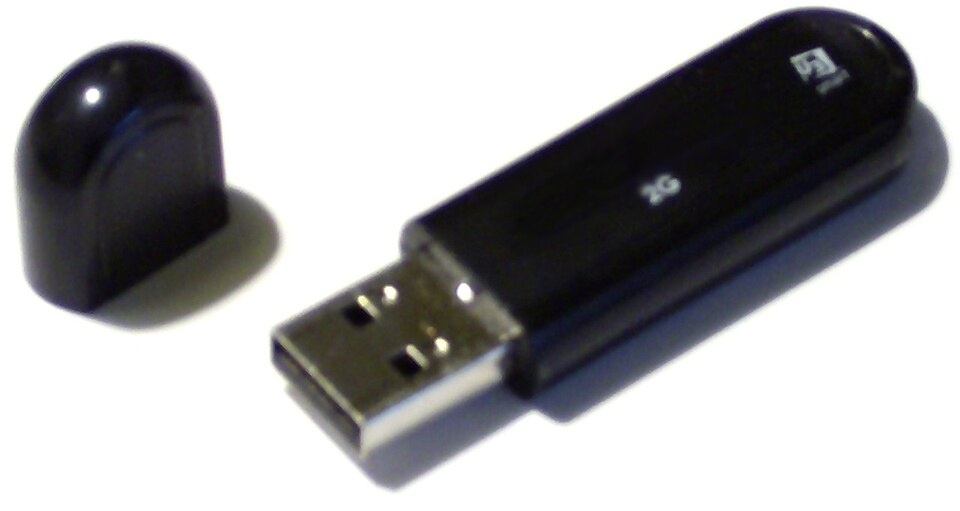

# Session 01: Basic Computer System Hardware / 第1回：基本的なシステムハードウェア

## Overview / 概要

**Shared diagram / 共通図**



{{#tabs }}
{{#tab name="English" }}
**Duration is about 15 minutes**, including time to explain the diagrams and answer questions.  
**The goal is to explain** the roles of the CPU, memory, and storage.

**The suggested pacing is as follows:** overview, 2 minutes; CPU, memory, and storage, 7 minutes; other devices, 4 minutes; summary and questions, 2 minutes.

This session covers the main parts of a computer. First, it explains the role of each part. Then, it shows how the parts work together. Linux runs on many kinds of hardware, so these parts are a useful starting point.

This diagram shows the main parts of a computer. Input devices send information to the computer. USB devices connect in a similar way. Inside the computer, the CPU, memory, storage, and expansion cards work together. The display shows the output.
{{#endtab }}
{{#tab name="日本語" }}
**所要時間は約15分です。** 図の説明や質問の時間を含みます。  
**ゴールは、CPU・メモリ・ストレージの役割を説明できることです。**

**時間配分の目安は次のとおりです。** 概要2分、CPU・メモリ・ストレージ7分、その他の機器4分、まとめと質問2分です。

この回では、コンピュータを構成する主な部品を扱います。最初に、それぞれの部品の役割を説明します。次に、部品同士の連携を確認します。Linuxは多くの種類のハードウェア上で動作するため、これらの部品はLinuxを学ぶ上での基礎です。

この図は、コンピュータの主な構成要素を示しています。入力装置からコンピュータに情報を送ります。USB機器も、コンピュータに接続して使います。コンピュータ内部では、CPU、メモリ、ストレージ、拡張カードが連携します。ディスプレイには、処理結果が表示されます。
{{#endtab }}
{{#endtabs }}

## 1. CPU / CPU

{{#tabs }}
{{#tab name="English" }}
<figure class="session-photo">

<figcaption>Photo: Intel Core i7 CPU by Asimzb / Wikimedia Commons, <a href="https://creativecommons.org/licenses/by-sa/4.0/">CC BY-SA 4.0</a>. <a href="https://commons.wikimedia.org/wiki/File:Intel_i7_6800k_cpu.jpg">Source</a>.</figcaption>
</figure>

First is the CPU. CPU stands for Central Processing Unit. It runs program instructions and does calculations. People often call it the “brain” of the computer.

CPUs also produce heat. They produce more heat when they do a lot of work. Data centers run many servers at the same time. So, they need cooling systems to keep the equipment at a safe temperature. Cooling is an important part of data center design and operation.

CPU clock speed is measured in gigahertz, or GHz. This is one clue about speed. But it does not tell the whole story. CPU architecture means the CPU's basic design and the instructions it can run.

Here are three common architectures. x86, or IA-32, is a 32-bit design. x86-64 is a 64-bit version of x86. ARM is common in phones and small devices. Linux supports many architectures, including these three.

| Architecture | Simple description |
| --- | --- |
| x86 / IA-32 | 32-bit design used in many Intel-compatible PCs. |
| x86-64 | 64-bit version of x86. |
| ARM | Common in phones and small devices. |
{{#endtab }}
{{#tab name="日本語" }}
<figure class="session-photo">

<figcaption>Photo: Intel Core i7 CPU by Asimzb / Wikimedia Commons, <a href="https://creativecommons.org/licenses/by-sa/4.0/">CC BY-SA 4.0</a>. <a href="https://commons.wikimedia.org/wiki/File:Intel_i7_6800k_cpu.jpg">Source</a>.</figcaption>
</figure>

まずはCPUです。CPUはCentral Processing Unitの略です。プログラムの命令を実行し、計算を行います。そのため、コンピュータの「頭脳」にたとえられます。

CPUは動作中に熱を発生します。特に、高い負荷が続くと多くの熱が出ます。データセンターでは、多数のサーバーが同時に稼働します。そのため、機器を安全な温度に保つ冷却設備が重要です。冷却技術は、データセンターの設計や運用を支える要素の一つです。

CPUの動作周波数は、ギガヘルツ（GHz）で表されます。速さを判断する目安のひとつですが、それだけで性能が決まるわけではありません。CPUアーキテクチャは、CPUの基本設計や実行できる命令の体系を表します。

代表的なアーキテクチャを3つ紹介します。x86、またはIA-32は32ビットの設計です。x86-64はx86を64ビットに拡張したものです。ARMは、スマートフォンや小型機器などで使われています。Linuxは、これらを含む多くのアーキテクチャに対応しています。

| アーキテクチャ | 概要 |
| --- | --- |
| x86 / IA-32 | Intel系PCなどで広く使われた32ビットの設計です。 |
| x86-64 | x86を64ビットに拡張したものです。 |
| ARM | スマートフォンや小型機器などで使われます。 |
{{#endtab }}
{{#endtabs }}

<details class="example-file">
<summary>C program, compiler, and instructions / Cプログラム、コンパイラ、命令</summary>

### C source and binary / Cソースコードとバイナリ

The CPU does not run C code or assembly text directly. GCC translates C into assembly for a target architecture. The assembler changes assembly into machine-code bytes. The linker combines the code with libraries and creates an executable. The CPU runs the machine-code instructions in the executable. The `printf` function is part of the C library, not a CPU instruction.

CPUはC言語やアセンブリのテキストをそのまま実行しません。GCCがC言語を対象アーキテクチャ向けのアセンブリに変換します。アセンブラがアセンブリを機械語のバイト列に変換します。リンカーが機械語とライブラリをまとめて実行ファイルを作ります。CPUは実行ファイル内の機械語命令を実行します。`printf` はCPU命令ではなく、Cライブラリの関数です。



The diagram shows both forms of the compiled result. The CPU executes the machine-code binary. The disassembler translates the binary back into readable instruction names. / 図はコンパイル結果の2つの表現を示しています。CPUが実行するのは機械語のバイナリです。逆アセンブラは、バイナリを人が読める命令名に変換します。

```c
#include <stdio.h> // Provides printf. / printfの宣言を使えるようにします。
int main(void) { // Program entry point. / プログラムの開始点です。
    printf("Hello, world!\n"); // Prints a message. / メッセージを表示します。
    return 0; // Reports success. / 正常終了を示します。
} // Ends main. / main関数の終わりです。
```

The examples below show a few instructions. They are not complete programs. / 以下は命令の例です。プログラム全体ではありません。

```asm
x86 / IA-32:
MOV EAX, EBX // Copy a value. / 値をコピーします。
ADD EAX, 1 // Add one. / 値に1を足します。
JMP label // Jump to another instruction. / 別の命令位置へ移ります。

x86-64:
MOV RAX, RBX // Copy a value between 64-bit registers. / 64ビットレジスタ間で値をコピーします。
ADD RAX, 1 // Add one. / 値に1を足します。
SYSCALL // Request an operating-system service. / OSに処理を依頼します。

AArch64:
LDR X0, [X1] // Load a value from memory. / メモリから値を読み込みます。
ADD X0, X0, #1 // Add one. / 値に1を足します。
B label // Jump to another instruction. / 別の命令位置へ移ります。
```

### Generated assembly / 生成されたアセンブリ

This is the AArch64 assembly generated from the C program. The assembler turns its instructions into machine-code bytes. / これはCプログラムから生成されたAArch64アセンブリです。アセンブラが命令を機械語のバイト列に変換します。

```asm
.arch armv8-a // Select ARMv8-A. / ARMv8-Aを対象にします。
.file "hello.c" // Record the source name. / ソースファイル名を記録します。
.text // Start the code section. / 命令のセクションを開始します。
.section .rodata // Select read-only data. / 読み取り専用データを選びます。
.align 3 // Align following data. / 次のデータの配置を整えます。
.LC0: // Label the string. / 文字列のラベルです。
.string "Hello, world!\n" // Store the message. / メッセージを保存します。
.text // Return to the code section. / 命令のセクションに戻ります。
.align 2 // Align the instructions. / 命令の配置を整えます。
.global main // Export main to the linker. / mainをリンカーから参照可能にします。
.type main, %function // Mark main as a function. / mainを関数として指定します。
main: // Function entry. / 関数の開始位置です。
.LFB0: // GCC local label. / GCCが生成したローカルラベルです。
.cfi_startproc // Start unwind metadata. / スタック復元情報を開始します。
stp x29, x30, [sp, -16]! // Save two registers. / 2つのレジスタを保存します。
.cfi_def_cfa_offset 16 // Record the stack offset. / スタック位置を記録します。
.cfi_offset 29, -16 // Record saved x29. / x29の保存位置を記録します。
.cfi_offset 30, -8 // Record saved x30. / x30の保存位置を記録します。
mov x29, sp // Set the frame pointer. / フレームポインタを設定します。
adrp x0, .LC0 // Load part of the string address. / 文字列アドレスの一部を読み込みます。
add x0, x0, :lo12:.LC0 // Add the remaining address. / 残りのアドレスを加えます。
bl printf // Call printf. / printfを呼び出します。
mov w0, 0 // Set the return value to zero. / 戻り値を0に設定します。
ldp x29, x30, [sp], 16 // Restore registers and stack. / レジスタとスタックを復元します。
.cfi_restore 30 // Record restored x30. / x30の復元を記録します。
.cfi_restore 29 // Record restored x29. / x29の復元を記録します。
.cfi_def_cfa_offset 0 // Mark the stack-frame end. / スタックフレームの終了を記録します。
ret // Return from main. / mainから戻ります。
.cfi_endproc // End unwind metadata. / スタック復元情報を終了します。
.LFE0: // GCC local label. / GCCが生成したローカルラベルです。
.size main, .-main // Record the function size. / 関数のサイズを記録します。
.ident "GCC: (GNU) 14.3.0" // Record the compiler version. / コンパイラのバージョンです。
.section .note.GNU-stack,"",@progbits // Add stack metadata. / スタック権限のメタデータです。
```

The block below shows all eight machine-code words for <code>main</code> in this build. Each word is one 32-bit AArch64 instruction. The CPU executes these encoded values, not the text labels. The output does not include C library code for <code>printf</code> or program startup code; those are linked separately. / 次のブロックは、このビルドで生成された <code>main</code> の機械語をすべて示しています。各行は32ビットのAArch64命令です。CPUが実行するのは命令名の文字列ではなく、符号化された値です。<code>printf</code> のCライブラリ本体やプログラムの起動コードは、別途リンクされるため含まれていません。

```text
a9bf7bfd = 10101001 10111111 01111011 11111101 // stp x29, x30, [sp, #-16]!
910003fd = 10010001 00000000 00000011 11111101 // mov x29, sp
90000000 = 10010000 00000000 00000000 00000000 // adrp x0, ...
911b0000 = 10010001 00011011 00000000 00000000 // add x0, x0, ...
97ffffaf = 10010111 11111111 11111111 10101111 // bl printf
52800000 = 01010010 10000000 00000000 00000000 // mov w0, 0
a8c17bfd = 10101000 11000001 01111011 11111101 // ldp x29, x30, [sp], 16
d65f03c0 = 11010110 01011111 00000011 11000000 // ret
```

Each hexadecimal word is the value printed by <code>objdump</code>. On this little-endian target, bytes are stored in reverse order within each word. / 16進数は <code>objdump</code> が表示する命令語です。このリトルエンディアン環境では、メモリ上のバイト順は各命令語の並びと逆になります。

### Compile and inspect / コンパイルと観察

This optional demonstration takes about five minutes. It needs Linux, GCC, and GNU binutils. Run the build script from the repository root. / この実演は任意で、所要時間は約5分です。Linux、GCC、GNU binutilsが必要です。リポジトリのルートからビルドスクリプトを実行します。

```sh
cd src/sessions/01-basic-system-hardware/examples
sh build.sh
```

The examples use GCC 14.3.0 for <code>aarch64-linux-gnu</code>. Results differ with another compiler or CPU. / 出力例はGCC 14.3.0で <code>aarch64-linux-gnu</code> 向けに生成しました。コンパイラやCPUが異なると結果も変わります。

The folder contains the C source, build script, compiler version and target, assembly output, disassembly, and run output. / フォルダにはCソース、ビルドスクリプト、コンパイラのバージョンと対象、アセンブリ、逆アセンブル結果、実行結果があります。

To watch the running program request output from Linux, run <code>strace</code>. This shows system calls, not every CPU instruction. If <code>strace</code> is not installed, install it with your Linux distribution's package manager. / 実行中のプログラムがLinuxに出力を依頼する様子は、<code>strace</code> で確認できます。これはシステムコールを表示するもので、CPU命令をすべて表示するものではありません。<code>strace</code> がない場合は、Linuxディストリビューションのパッケージマネージャーでインストールします。

```sh
strace -e trace=write,writev ./hello
```

The trace may include a line like this. It shows a write request to file descriptor 1, which is standard output. / 出力には、次のような行が含まれます。ファイルディスクリプター1（標準出力）への書き込みを示しています。

```text
write(1, "Hello, world!\n", 14) = 14
```

The number 14 is the number of bytes written. Use GDB's <code>stepi</code> command to observe individual CPU instructions. / 数値の14は、書き込まれたバイト数です。CPU命令を1つずつ確認する場合は、GDBの <code>stepi</code> を使います。

If GDB is installed, use these commands to step through instructions. / GDBがインストールされている場合は、次のコマンドで命令を1つずつ実行できます。

```text
gdb -q ./hello
(gdb) break main
(gdb) run
(gdb) display/i $pc
(gdb) stepi
(gdb) continue
(gdb) quit
```

Each <code>stepi</code> runs one machine instruction. / <code>stepi</code> を実行するたびに、機械語の命令が1つ実行されます。
</details>

## 2. Memory / メモリ

**Shared diagram / 共通図: CPU, Memory, and Storage**



{{#tabs }}
{{#tab name="English" }}
<figure class="session-photo">

<figcaption>Photo: RAM DIMM by D-Kuru / Wikimedia Commons, <a href="https://creativecommons.org/licenses/by-sa/3.0/at/">CC BY-SA 3.0 AT</a>. <a href="https://commons.wikimedia.org/wiki/File:RAM_DIMM_4GB_by_Kingston-top_PNr%C2%B00306.jpg">Source</a>.</figcaption>
</figure>

Next is memory. It holds the programs and data that the CPU is using now. So, memory is the computer's workspace.

Most memory is volatile. This means its contents disappear when the power is off. For example, an open document is held in memory while you work. If you do not save your changes, you may lose them when the computer shuts down.

The source book gives 512 MB to 1 GB as a rough guide for running Linux. This is the book's figure, not a current recommendation. The amount of memory you need depends on the Linux system and how you use it.

Programs and files move from storage to memory when we open them. The CPU reads instructions and data from memory. It sends results back to memory. When we save a file, the data goes from memory to storage.
{{#endtab }}
{{#tab name="日本語" }}
<figure class="session-photo">

<figcaption>Photo: RAM DIMM by D-Kuru / Wikimedia Commons, <a href="https://creativecommons.org/licenses/by-sa/3.0/at/">CC BY-SA 3.0 AT</a>. <a href="https://commons.wikimedia.org/wiki/File:RAM_DIMM_4GB_by_Kingston-top_PNr%C2%B00306.jpg">Source</a>.</figcaption>
</figure>

メモリは、CPUが今使っているプログラムやデータを保持します。コンピュータの作業場所にあたります。

メモリの多くは揮発性です。電源を切ると、内容が消えてしまいます。たとえば、文書を編集中は、作業中の内容がメモリにあります。変更を保存していないと、電源を切ったときに失われることがあります。

参考書には、Linuxを動かすメモリ容量の目安として512MB〜1GBとあります。これは書籍に記載された数値で、現在の推奨要件ではありません。必要な容量は、Linuxの種類や用途によって変わります。

プログラムやファイルを開くと、ストレージからメモリに読み込まれます。CPUはメモリから命令やデータを読み取って処理し、結果をメモリに戻します。ファイルを保存すると、データがメモリからストレージに書き込まれます。
{{#endtab }}
{{#endtabs }}

## 3. Storage / ストレージ

{{#tabs }}
{{#tab name="English" }}
<figure class="session-photo">

<figcaption>Photo: HDD and SSD by Santeri Viinamäki / Wikimedia Commons, <a href="https://creativecommons.org/licenses/by-sa/4.0/">CC BY-SA 4.0</a>. <a href="https://commons.wikimedia.org/wiki/File:HDD_and_SSD_20180314.jpg">Source</a>.</figcaption>
</figure>

Storage keeps data when the power is off. The operating system, programs, and files are saved there.

Two common types are hard disk drives, or HDDs, and solid-state drives, or SSDs. An SSD uses flash memory. Storage can be inside or outside the computer. In our example, saving a document writes it to storage. So, we can open it again later.
{{#endtab }}
{{#tab name="日本語" }}
<figure class="session-photo">

<figcaption>Photo: HDD and SSD by Santeri Viinamäki / Wikimedia Commons, <a href="https://creativecommons.org/licenses/by-sa/4.0/">CC BY-SA 4.0</a>. <a href="https://commons.wikimedia.org/wiki/File:HDD_and_SSD_20180314.jpg">Source</a>.</figcaption>
</figure>

次はストレージです。電源を切った後もデータを保存します。OSやプログラム、ファイルなどはストレージに保存されます。

代表的なものは、ハードディスクドライブ（HDD）とソリッドステートドライブ（SSD）です。SSDはフラッシュメモリを使います。ストレージには内蔵型と外付け型があります。文書を保存すると、ストレージに書き込まれるため、後からまた開くことができます。
{{#endtab }}
{{#endtabs }}

## 4. Input devices / 入力装置

{{#tabs }}
{{#tab name="English" }}
<figure class="session-photo">

<figcaption>Photo: Keyboard and mouse by Lady Aleena / Wikimedia Commons, <a href="https://commons.wikimedia.org/wiki/File:Microsoft_Natural_Ergonomic_Keyboard_4000_and_mouse.jpg">Public domain</a>.</figcaption>
</figure>

Input devices send information to a computer. A keyboard enters text and commands. A mouse moves the pointer on the screen.

Some servers do not have a keyboard or mouse attached. People can manage them over a network instead.
{{#endtab }}
{{#tab name="日本語" }}
<figure class="session-photo">

<figcaption>Photo: Keyboard and mouse by Lady Aleena / Wikimedia Commons, <a href="https://commons.wikimedia.org/wiki/File:Microsoft_Natural_Ergonomic_Keyboard_4000_and_mouse.jpg">Public domain</a>.</figcaption>
</figure>

入力装置は、コンピュータに情報を送ります。キーボードでは文字やコマンドを入力し、マウスでは画面上のポインタを操作します。

サーバの中には、キーボードやマウスを接続しないものもあります。その場合は、ネットワーク経由で管理できます。
{{#endtab }}
{{#endtabs }}

## 5. Expansion cards / 拡張カード

{{#tabs }}
{{#tab name="English" }}
<figure class="session-photo">

<figcaption>Photo: PCI USB expansion card by Sönke Kraft (Arnulf zu Linden) / Wikimedia Commons, <a href="https://creativecommons.org/licenses/by-sa/3.0/">CC BY-SA 3.0</a>. <a href="https://commons.wikimedia.org/wiki/File:PCI-USB11-card.jpg">Source</a>.</figcaption>
</figure>

Expansion cards add features to a computer. They fit into slots on the motherboard. For example, a network interface card, or NIC, adds a network connection. A sound card handles audio. A modem card supports communication through a modem. A video card handles display output. A SCSI card connects SCSI devices. A RAID card manages several disks together. Turn off the computer before you install or remove a card.

| Card | Main job |
| --- | --- |
| NIC | Connects to a network. |
| Sound card | Handles audio input or output. |
| Modem card | Connects through a modem. |
| Video card | Handles display output. |
| SCSI card | Connects SCSI devices. |
| RAID card | Manages several disks. |
{{#endtab }}
{{#tab name="日本語" }}
<figure class="session-photo">

<figcaption>Photo: PCI USB expansion card by Sönke Kraft (Arnulf zu Linden) / Wikimedia Commons, <a href="https://creativecommons.org/licenses/by-sa/3.0/">CC BY-SA 3.0</a>. <a href="https://commons.wikimedia.org/wiki/File:PCI-USB11-card.jpg">Source</a>.</figcaption>
</figure>

拡張カードは、コンピュータに機能を追加します。マザーボード上のスロットに取り付けます。たとえば、ネットワークカードはネットワーク接続を追加します。サウンドカードは音声を扱い、ビデオカードは映像を出力します。SCSIカードはSCSI機器を接続し、RAIDカードは複数のディスクを管理します。カードを取り付けたり外したりするときは、原則として電源を切ります。

| カード | 主な役割 |
| --- | --- |
| NIC | ネットワークに接続します。 |
| サウンドカード | 音声を入出力します。 |
| モデムカード | モデムで通信します。 |
| ビデオカード | 画面に映像を出力します。 |
| SCSIカード | SCSI機器を接続します。 |
| RAIDカード | 複数のディスクを管理します。 |
{{#endtab }}
{{#endtabs }}

## 6. USB devices / USB機器

{{#tabs }}
{{#tab name="English" }}
<figure class="session-photo">

<figcaption>Photo: USB flash drive by Peter Hosey / Wikimedia Commons, <a href="https://creativecommons.org/licenses/by/2.0/">CC BY 2.0</a>. <a href="https://commons.wikimedia.org/wiki/File:USB_flash_drive_(unbranded).jpg">Source</a>.</figcaption>
</figure>

USB stands for Universal Serial Bus. It is a common way to connect devices. Keyboards, mice, external drives, USB flash drives, and DVD drives are examples.

Many USB devices can be connected or removed while the computer is on. But use the safe removal option before unplugging a storage device. The computer may still be saving data. Safe removal helps protect your files.
{{#endtab }}
{{#tab name="日本語" }}
<figure class="session-photo">

<figcaption>Photo: USB flash drive by Peter Hosey / Wikimedia Commons, <a href="https://creativecommons.org/licenses/by/2.0/">CC BY 2.0</a>. <a href="https://commons.wikimedia.org/wiki/File:USB_flash_drive_(unbranded).jpg">Source</a>.</figcaption>
</figure>

USBはUniversal Serial Busの略で、周辺機器を接続する規格です。キーボード、マウス、外付けドライブ、USBメモリ、DVDドライブなどがあります。

多くのUSB機器は、電源を入れたまま接続・取り外しができます。ただし、ストレージを外すときは、安全な取り外し操作を行います。書き込みが続いている場合があるためです。適切に取り外すことで、ファイルを保護できます。
{{#endtab }}
{{#endtabs }}

## Summary / まとめ

{{#tabs }}
{{#tab name="English" }}
The main points are these. The CPU runs instructions. Memory holds current work. Storage keeps saved data. Input devices send information. Expansion cards add features, and USB connects many kinds of devices.

The most important point is this: the CPU processes data, memory holds it while we work, and storage keeps it for later. This is the basic difference to remember.
{{#endtab }}
{{#tab name="日本語" }}
最後に、今日の内容を振り返ります。CPUは命令を実行します。メモリは作業中の情報を保持します。ストレージは保存したデータを残します。入力装置は情報を送り、拡張カードは機能を追加し、USBはさまざまな機器を接続します。

特に大切なのは、CPUはデータを処理し、メモリは作業中の情報を保持し、ストレージはデータを後から使えるように保存する、という違いです。
{{#endtab }}
{{#endtabs }}
